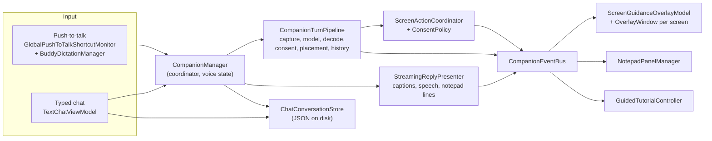

# System Architecture and Ownership Boundaries

elfhub is a single macOS app target (`elfhub/`). It has no elfhub server, account, analytics or update feed. It only makes network requests to the model, speech and voice services the user configures with their own keys, or to model servers on their own Mac (`Config/Shared.xcconfig:5-10`).

- **Keys** live in the Keychain.
- **Chats** are JSON files in Application Support.
- **Updates** are downloaded by hand from GitHub Releases.

## The three model layers

Each turn passes through three independently configured layers. They are chosen in Settings › Models and in onboarding step 1.

| Layer | Choice type | Options (default first) |
|---|---|---|
| Speech-to-text | `TranscriptionProviderChoice` | Apple on-device (SpeechAnalyzer on macOS 26+, SFSpeechRecognizer before), AssemblyAI, any OpenAI-compatible `/audio/transcriptions` |
| Language model | `ProviderConfiguration` in `ProviderConfigurationStore` | Anthropic, OpenAI-compatible (OpenAI, OpenRouter, Mistral, xAI, Groq, DeepSeek, Together, Ollama, LM Studio, llama.cpp, custom), Gemini. There is no default model; the user adds one. |
| Text-to-speech | `SpeechOutputMode` | Apple on-device, ElevenLabs, OpenAI-compatible `/audio/speech`, off |

<!-- openwiki: broken internal link [/openwiki/concepts/providers-configuration-and-persistence.md] link "/openwiki/concepts/providers-configuration-and-persistence.md" is root-absolute, which no real consumer resolves against the repository root (not a coding agent reading the page, not GitHub's Markdown renderer, not a local viewer); use a path relative to this file instead. Fix the href or restore the target, then delete this comment. -->
The language model can be text-only. `ProviderConfiguration.supportsVision` decides whether screenshots are sent, and a model that can't see still talks and chats. Details: [Model layers](/openwiki/concepts/providers-configuration-and-persistence.md).

## Who owns what

<!-- openwiki: broken internal link [/openwiki/architecture/macos-runtime.md] link "/openwiki/architecture/macos-runtime.md" is root-absolute, which no real consumer resolves against the repository root (not a coding agent reading the page, not GitHub's Markdown renderer, not a local viewer); use a path relative to this file instead. Fix the href or restore the target, then delete this comment. -->
- **`CompanionManager`** is the shared `@MainActor` coordinator. It routes voice and chat turns, holds preferences and voice state, and owns every manager. See [macOS runtime](/openwiki/architecture/macos-runtime.md).
- **`CompanionTurnPipeline`** runs one turn for voice and chat alike:
  1. capture the screen under the cursor;
  2. call the model, using native tools or text tags;
  3. decode the guidance;
  4. normalize coordinates;
  5. pass actions through the consent gate;
  6. place the guidance;
  7. record history.

<!-- openwiki: broken internal link [/openwiki/workflows/conversation-turn.md] link "/openwiki/workflows/conversation-turn.md" is root-absolute, which no real consumer resolves against the repository root (not a coding agent reading the page, not GitHub's Markdown renderer, not a local viewer); use a path relative to this file instead. Fix the href or restore the target, then delete this comment. -->
  It returns a `TurnResult` with the spoken text, the screenshot it sent, the guidance it drew, the user's ink and the notepad (`elfhub/CompanionTurnPipeline.swift:5-43`). See [A conversation turn](/openwiki/workflows/conversation-turn.md).
- **`CompanionEventBus`** is a typed in-process channel. The pipeline, the reply presenter and the action coordinator emit events. The overlay model, the tutorial and the notepad panel subscribe. The overlay never reads `CompanionManager` state, so a future agent loop can drive the same surfaces by emitting the same events (`elfhub/CompanionEventBus.swift:5-50`).
<!-- openwiki: broken internal link [/openwiki/workflows/screen-targeting-and-actions.md] link "/openwiki/workflows/screen-targeting-and-actions.md" is root-absolute, which no real consumer resolves against the repository root (not a coding agent reading the page, not GitHub's Markdown renderer, not a local viewer); use a path relative to this file instead. Fix the href or restore the target, then delete this comment. -->
- **`ScreenGuidanceOverlayModel`** owns all on-screen timing: how long the pointer, annotations, the user's ink and the status pill stay up (`elfhub/CompanionEventBus.swift:77-311`). See [Screen targeting](/openwiki/workflows/screen-targeting-and-actions.md).
<!-- openwiki: broken internal link [/openwiki/workflows/notepad.md] link "/openwiki/workflows/notepad.md" is root-absolute, which no real consumer resolves against the repository root (not a coding agent reading the page, not GitHub's Markdown renderer, not a local viewer); use a path relative to this file instead. Fix the href or restore the target, then delete this comment. -->
- **`NotepadPanelManager`** owns the floating notepad, which lives outside the overlay's timing rules. See [Notepad](/openwiki/workflows/notepad.md).
- **`ScreenActionCoordinator`** owns real clicks, typing, scrolling and keys. Every action passes through `ConsentPolicy`, gets a pointer preview, and can be stopped with Esc or by the user touching the mouse or keyboard.
<!-- openwiki: broken internal link [/openwiki/concepts/chat-history.md] link "/openwiki/concepts/chat-history.md" is root-absolute, which no real consumer resolves against the repository root (not a coding agent reading the page, not GitHub's Markdown renderer, not a local viewer); use a path relative to this file instead. Fix the href or restore the target, then delete this comment. -->
- **`ChatConversationStore` and `TextChatViewModel`** record typed and spoken turns through one exchange API. See [Chat history](/openwiki/concepts/chat-history.md).

## Network boundary

What leaves the Mac depends only on the user's choices:

- **Language model.** The prompt, history and (for a vision model) one JPEG of the cursor's display go to the configured base URL. If that URL is local (`localhost`, `127.0.0.1`, `::1`, `*.local`), nothing reaches a cloud API (`elfhub/ProviderConfiguration.swift:149-153`, `:199-203`).
- **Speech-to-text and text-to-speech.** These are on-device by default. A cloud service is called only when the user picks it and adds a key.
- **Ollama.** `OnDeviceModelAssistant` only ever talks to `http://localhost:11434`; Ollama does the downloads.
- **Screenshots.** They exclude elfhub's own windows and any app on the privacy blocklist, such as password managers, at capture time.

<!-- openwiki: broken internal link [/openwiki/integrations/external-services.md] link "/openwiki/integrations/external-services.md" is root-absolute, which no real consumer resolves against the repository root (not a coding agent reading the page, not GitHub's Markdown renderer, not a local viewer); use a path relative to this file instead. Fix the href or restore the target, then delete this comment. -->
Full list: [External services](/openwiki/integrations/external-services.md).

## Invariants

- **The guidance contract is model-agnostic.**
  - Models with tool calling get `point_at`, `annotate` and `perform_screen_action` tools.
  - Every other model writes text tags.
  - Both produce the same `ScreenGuidanceCommand`s.
  - Notepad tags are used by every model, because tool calls arrive only after streaming ends.
- **Conversation history** is limited to the 10 most recent exchanges, stored as plain text pairs. A notepad is appended to the assistant text, because the notepad window is never in screenshots (`elfhub/CompanionTurnPipeline.swift:49-51`, `:247-253`).
- **On failure,** a turn speaks a short error with the on-device voice. If the cause is a missing setup step, it says what to fix (`elfhub/CompanionManager.swift:940-952`).

## Related pages

<!-- openwiki: broken internal link [/openwiki/architecture/macos-runtime.md] link "/openwiki/architecture/macos-runtime.md" is root-absolute, which no real consumer resolves against the repository root (not a coding agent reading the page, not GitHub's Markdown renderer, not a local viewer); use a path relative to this file instead. Fix the href or restore the target, then delete this comment. -->
- [macOS runtime](/openwiki/architecture/macos-runtime.md)
<!-- openwiki: broken internal link [/openwiki/workflows/conversation-turn.md] link "/openwiki/workflows/conversation-turn.md" is root-absolute, which no real consumer resolves against the repository root (not a coding agent reading the page, not GitHub's Markdown renderer, not a local viewer); use a path relative to this file instead. Fix the href or restore the target, then delete this comment. -->
- [A conversation turn](/openwiki/workflows/conversation-turn.md)
<!-- openwiki: broken internal link [/openwiki/concepts/providers-configuration-and-persistence.md] link "/openwiki/concepts/providers-configuration-and-persistence.md" is root-absolute, which no real consumer resolves against the repository root (not a coding agent reading the page, not GitHub's Markdown renderer, not a local viewer); use a path relative to this file instead. Fix the href or restore the target, then delete this comment. -->
- [Model layers and secrets](/openwiki/concepts/providers-configuration-and-persistence.md)
<!-- openwiki: broken internal link [/openwiki/integrations/external-services.md] link "/openwiki/integrations/external-services.md" is root-absolute, which no real consumer resolves against the repository root (not a coding agent reading the page, not GitHub's Markdown renderer, not a local viewer); use a path relative to this file instead. Fix the href or restore the target, then delete this comment. -->
- [External services](/openwiki/integrations/external-services.md)
