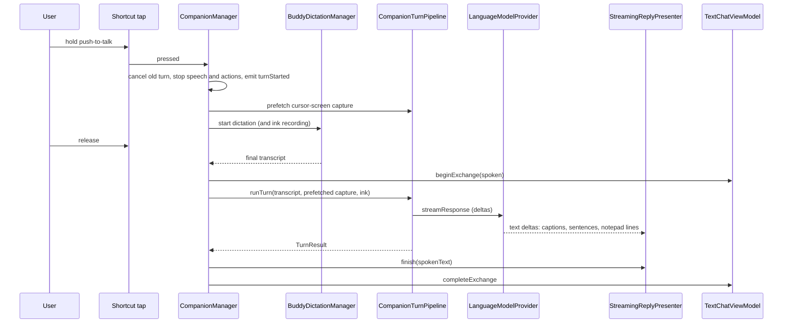

# A Conversation Turn: Voice and Chat

Voice and typed chat share one pipeline. They differ only in how the user's words arrive and in some bookkeeping around the turn.

## 1. Voice capture

The global push-to-talk monitor is a listen-only `CGEvent` tap, so modifier-only shortcuts such as ctrl+option work while another app has focus. The chosen shortcut is cached in memory, because the tap reads it on every key event.

**On press** (`elfhub/CompanionManager.swift:751-795`):

1. Dismiss the menu bar panel.
2. Cancel the previous response task, speech and running actions, and emit `.turnStarted`, which clears the old pointer and marks.
3. Start recording the user's ink if Accessibility is granted. While the keys are held, mouse drags draw instead of clicking.
4. Start a capture of the display under the cursor right away, so the screenshot is off the critical path.
5. Start dictation.

**On release:** cancel a start that hasn't begun yet, finish the ink recording, and stop dictation.

Dictation rolls a start-request UUID and checks for cancellation at several points, so a quick press-and-release can't bring back a session that was already torn down (`elfhub/BuddyDictationManager.swift:440-500`).

On stop, the dictation manager asks the transcription session for a final transcript. It then waits up to that provider's fallback deadline:

| Provider | Deadline |
|---|---|
| SFSpeechRecognizer | 1.8 s |
| SpeechAnalyzer | 2.5 s |
| AssemblyAI | 2.8 s |
| Whisper upload | 8 s |

If no final transcript arrives in time, it uses the best partial text (`elfhub/BuddyDictationManager.swift:520-560`).

`handleFinalTranscript` plays the "accepted" earcon. If a screen action is waiting for consent, the utterance answers it:

- **Affirmative** ("go", "yes", "do it"…) confirms.
- **Negative** ("no", "cancel", "wait"…) cancels.
- **Anything else** silently drops the pending action and becomes a new request.

(`elfhub/CompanionManager.swift:705-749`)

## 2. The voice path

`sendTranscriptToClaudeWithScreenshot` (`elfhub/CompanionManager.swift:822-890`):

1. Tags the turn with a fresh response id, so an older cancelled turn finishing late can't clear the newer one.
2. Reads which display the cursor is on now. The prefetched capture is reused only if it shows that display; otherwise the pipeline captures again.
3. Records the question with `beginExchange(inputSource: .spoken)`. After 30 quiet minutes this starts a new conversation.
4. Runs the pipeline with the transcript, the reusable capture and the ink. It streams each delta to the presenter and to the chat bubble.
5. On success, calls `finish(finalSpokenText:)` and `completeExchange`, and plays the "needs confirmation" earcon if a consent card is open. On `CancellationError` (the user spoke again), calls `abandon()` and `saveInterruptedExchange`. On any other error, calls `abandon()` and `failExchange`, then speaks the error fallback.

## 3. The chat path

`TextChatViewModel.sendDraft()` calls `beginExchange(inputSource: .typed)`, then `CompanionManager.respondToChatMessage`. That method:

- stops speech and actions;
- emits `.turnStarted`;
- notifies the tutorial;
- runs the same pipeline with no prefetched capture;
- presents the reply through the same `StreamingReplyPresenter`, so typed turns are spoken when a voice is on.

(`elfhub/CompanionManager.swift:896-935`, `elfhub/TextChatView.swift:80-104`)

## 4. Inside `CompanionTurnPipeline.runTurn`

`elfhub/CompanionTurnPipeline.swift:88-271`:

1. **Provider.** `makeActiveProvider()` is rebuilt each turn, and its capabilities decide vision, tools and the coordinate convention.
2. **Capture.** Use the prefetched capture, or capture the cursor's display sized for the model's `ModelVisionProfile`.
3. **Ink.** For vision models, the user's strokes are drawn into the screenshot. A note such as "circled the area from (x, y) to (x, y)", in the model's own coordinates, is appended to the user's text. The un-inked image is kept as `originalScreenshotJPEGData` for chat.
4. **Prompt.** `CompanionPromptBuilder` combines:
   - the conversation rules;
   - a description of the coordinate convention;
   - the guidance instructions for tools or tags;
   - the action instructions, only when action mode is on;
   - the notepad instructions, always.

   Each image's label states its pixel size or normalized grid.
5. **Model call.** The response streams; text deltas go to `onReplyTextDelta`. If a tool-calling model returns tool calls but no words, the pipeline sends one follow-up. That follow-up answers each tool call with "shown to the user on their screen" and replays the assistant turn verbatim, including Claude's thinking blocks.
6. **Decode.** `decodeGuidance` strips notepad tags first, then decodes tags. In tool mode it also decodes tool calls, keeping tag annotations and preferring the tool's pointer. The notepad is parsed from the raw reply.
7. **Normalize.** Every coordinate becomes a pixel in the sent screenshot.
8. **Consent.** Actions go to `ScreenActionCoordinator`. If the coordinator takes ownership, it also owns the pointer.
9. **Place.** Pointer and annotations are placed with Accessibility refinement and emitted as `.guidancePlaced`.
10. **History.** The pipeline appends `(userText, spokenText + notepad)` and trims the history to the last 10 turns.

## 5. Streaming presentation

`StreamingReplyPresenter` (`elfhub/StreamingSpeechPlayer.swift:247-319`) drives three things:

- **Captions.** It emits `.responseCaptionAvailable` with the speakable text so far, including half-written tags trimmed off.
- **Speech.** `SpokenSentenceSegmenter` turns deltas into whole sentences. It strips every guidance and notepad tag, holds back a half-written one, and joins sentences shorter than 24 characters, except across a notepad line. Each sentence is queued on `StreamingSpeechPlayer`, which prepares the next sentence while the current one plays. If the chosen voice fails, the rest of the reply continues with the on-device voice.
<!-- openwiki: broken internal link [/openwiki/workflows/notepad.md] link "/openwiki/workflows/notepad.md" is root-absolute, which no real consumer resolves against the repository root (not a coding agent reading the page, not GitHub's Markdown renderer, not a local viewer); use a path relative to this file instead. Fix the href or restore the target, then delete this comment. -->
- **Notepad lines** are shown as the sentence after them starts ([Notepad](/openwiki/workflows/notepad.md)).

`finish` flushes the segmenter, closes the utterance and sets the final caption from the decoder's clean text. `abandon` stops speech but still reveals every notepad line already written.

Consent prompts are spoken with `speakAfterCurrentUtterance`, so they never cut off the reply.

## 6. Errors

`speakResponseErrorFallback` plays the "failed" earcon and speaks with the on-device voice, because the configured voice may be what's down:

- "I can't answer yet: …" for a missing configuration;
- a refusal message for a Claude API refusal;
- a generic "check your connection or model settings" otherwise.

(`elfhub/CompanionManager.swift:940-952`)

## Related pages

<!-- openwiki: broken internal link [/openwiki/workflows/screen-targeting-and-actions.md] link "/openwiki/workflows/screen-targeting-and-actions.md" is root-absolute, which no real consumer resolves against the repository root (not a coding agent reading the page, not GitHub's Markdown renderer, not a local viewer); use a path relative to this file instead. Fix the href or restore the target, then delete this comment. -->
- [Screen targeting and actions](/openwiki/workflows/screen-targeting-and-actions.md)
<!-- openwiki: broken internal link [/openwiki/workflows/notepad.md] link "/openwiki/workflows/notepad.md" is root-absolute, which no real consumer resolves against the repository root (not a coding agent reading the page, not GitHub's Markdown renderer, not a local viewer); use a path relative to this file instead. Fix the href or restore the target, then delete this comment. -->
- [Notepad](/openwiki/workflows/notepad.md)
<!-- openwiki: broken internal link [/openwiki/concepts/chat-history.md] link "/openwiki/concepts/chat-history.md" is root-absolute, which no real consumer resolves against the repository root (not a coding agent reading the page, not GitHub's Markdown renderer, not a local viewer); use a path relative to this file instead. Fix the href or restore the target, then delete this comment. -->
- [Chat history](/openwiki/concepts/chat-history.md)
<!-- openwiki: broken internal link [/openwiki/concepts/providers-configuration-and-persistence.md] link "/openwiki/concepts/providers-configuration-and-persistence.md" is root-absolute, which no real consumer resolves against the repository root (not a coding agent reading the page, not GitHub's Markdown renderer, not a local viewer); use a path relative to this file instead. Fix the href or restore the target, then delete this comment. -->
- [Model layers and secrets](/openwiki/concepts/providers-configuration-and-persistence.md)
