# The Notepad: Written Explanations in Step with Speech

When something is easier to follow written down (steps, a command, code, a formula, a short comparison), the model can write it into a floating notepad. The notepad fills in line by line as elfhub speaks, stays until the user closes it, and is saved whole with the reply in chat.

## The tag contract

The model writes silent tags inside its reply text (`elfhub/Notepad.swift:5-15`):

```text
[NOTEPAD:short title]            opens the notepad
[NOTEPAD_LINE:one markdown line] adds a line
```

**Every model uses tags, even models that point with tools.** Tool calls only arrive after the stream ends, and the lines have to appear while elfhub is still talking (`elfhub/CompanionTurnPipeline.swift:366-369`).

The prompt's `notepadInstructions` tell the model to:

- **alternate strictly:** spoken sentence, then the one line it introduces, then the next sentence, then the next line;
- never write two lines in a row, except the lines of a fenced code block;
- never write the whole notepad at the start or end;
- avoid `]` inside a line;
- write one notepad per reply, at most 40 lines;
- talk around the notepad instead of reading it aloud.

The general "no markdown" rule names notepad lines as its only exception (`elfhub/CompanionTurnPipeline.swift:372-378`, `:421-433`).

`NotepadTagParser` matches `\[(NOTEPAD_LINE|NOTEPAD):([^\]]*)\]`. `NOTEPAD_LINE` is listed first so the shorter name never claims its prefix. A title only counts before the first line, and defaults to "Notes". A reply with no lines has no notepad. Lines are trimmed, except that leading spaces inside a code fence are kept as indentation (`elfhub/Notepad.swift:32-101`).

The pipeline strips notepad tags before guidance decoding, so a `[POINT:…]` at the very end of the reply still counts as the end (`elfhub/CompanionTurnPipeline.swift:277-283`).

## Keeping lines in step with speech

```mermaid
flowchart LR
    Deltas["reply deltas"] --> Seg["SpokenSentenceSegmenter\nattaches each notepad item\nto the sentence after it"]
    Seg -->|SpokenSentenceSegment| Pres["StreamingReplyPresenter"]
    Pres -->|"voice on: enqueue(sentence, onSentenceStarted)"| Player["StreamingSpeechPlayer"]
    Player -->|sentence starts| Rev["NotepadItemRevealer"]
    Pres -->|"voice off: right away"| Rev
    Rev -->|"notepadOpened / notepadLineWritten"| Bus["CompanionEventBus"]
    Bus --> Panel["NotepadPanelManager\n+ NotepadPanelModel (pacing)"]
```



1. **Segmenting.** `SpokenSentenceSegmenter` treats `NOTEPAD` and `NOTEPAD_LINE` as silent tags: never spoken or captioned, and held back while half-written. For each complete tag it measures how much speakable text comes before the tag. The tag is then handed out with the first sentence that ends after that point, as `SpokenSentenceSegment.notepadItemsToShowFirst`. Tags after the last sentence come out of `finish()` as an empty-text segment (`elfhub/SpokenSentenceSegmenter.swift:93-149`).
2. **No joining across a line.** Short sentences (under 24 characters) are normally joined so speech isn't chopped up. They are never joined across a notepad line, because the line must appear between them (`elfhub/SpokenSentenceSegmenter.swift:177-195`).
3. **Revealing at sentence start.** With a voice on, the presenter calls `enqueue(sentence:onSentenceStarted:)`. `StreamingSpeechPlayer` runs that action just before the sentence plays. An empty sentence only runs its action. Stopping the player (Esc, a new turn, an error) runs every pending action, so lines that were already written are never lost (`elfhub/StreamingSpeechPlayer.swift:78-153`, `:190-194`). With the voice off, lines are revealed as soon as their segment completes (`elfhub/StreamingSpeechPlayer.swift:303-318`).
4. **One set of rules.** `NotepadItemRevealer` emits `.notepadOpened(title:)` on the first line and `.notepadLineWritten` per line. It applies the same rules as the parser (title only before the first line, at most 40 lines, same cleaning), so the window always matches what chat saves. `abandon()` reveals whatever the raw reply contains that hasn't been shown yet (`elfhub/StreamingSpeechPlayer.swift:294-301`, `:321-365`).
5. **Pacing.** `NotepadPanelModel` shows lines that arrive together, from a model that ignored the alternation or a fast stream with the voice off, one at a time, 0.45 s apart. Code-fence lines don't use up a beat. Opening a new notepad drops lines still waiting from the old one (`elfhub/NotepadPanelManager.swift:22-99`).

## The window

`NotepadPanelManager` subscribes to the two events (`elfhub/NotepadPanelManager.swift:101-216`).

- **Placement.** A new notepad replaces any open one. The window opens 24 pt in from the top-right of the visible frame of the screen under the mouse, 380 pt wide.
- **Growth.** It grows downward with its content, keeping its top edge wherever the user dragged it, up to 70% of the screen height. After that the lines scroll and the view follows the newest line.
- **Window type.** It is a borderless, non-activating `NSPanel` at `.floating` level that joins all Spaces and can become key. Text is selectable and ⌘C works, without pulling the user out of their app.
- **Lifetime.** Only the X closes it. Turns, Esc and overlay timers never touch it. Like every elfhub window, it is excluded from screenshots.

`FloatingNotepadView` (`elfhub/NotepadViews.swift:157-300`):

- **Header:** an X at the top left, the title, and the copy button at the top right.
- **Dragging:** the header is the drag handle. `NotepadWindowDragArea` hosts an AppKit view that calls `window.performDrag(with:)` and shows an open-hand cursor, because SwiftUI content inside `NSHostingView` can't move a borderless window by itself.
- **Copy button:** a `Menu` whose main click copies `plainText`. Its menu also offers "Copy as Markdown" (`markdownText`). A checkmark confirms the copy for 1.5 s.

`plainText` removes `#`, `**`, backticks and fences, turns bullets into "•", and keeps step numbers (`elfhub/Notepad.swift:110-137`).

Rendering uses `NotepadBlock`. Each line becomes a heading (levels clamped to 3), a bullet, a numbered step, a quote, a rule, a code block (everything between fences, including an unclosed fence while streaming) or a paragraph. Inline markdown is rendered through `AttributedString`. Sizes are fixed: body 13 pt, headings 17/15/13.5 pt, code 12 pt monospaced (`elfhub/Notepad.swift:147-245`, `elfhub/NotepadViews.swift:14-99`).

## Persistence and memory

- **Turn result.** `TurnResult.shownNotepad` is parsed from the full reply. It is saved on the assistant message as `StoredChatMessage.notepad`, and is also saved from interrupted replies. Chat shows it whole as `SavedNotepadCard`, with the same copy button.
- **Model history.** The model never sees the window in screenshots. Instead, the notepad is appended to its history as `[notepad shown on screen: title]` followed by the lines, both live and when a saved chat is reopened. Follow-ups like "what was step two?" therefore work.

(`elfhub/CompanionTurnPipeline.swift:247-250`, `elfhub/ChatConversationStore.swift:151-156`, `:197-214`, `elfhub/Notepad.swift:139-144`)

## Tests

`NotepadTests` covers:

- **Parsing:** parsing and caps, and that `[NOTE:]` and `[NOTEPAD:]` are kept apart;
- **Rendering:** blocks, and both copies;
- **Speech sync:** a line attached to the sentence after it, tags split across chunks, trailing lines, and no joining across lines;
- **Pacing:** pacing, and dropping waiting lines when a new notepad opens;
- **Persistence:** the prompt, the saved notepad, legacy chats, and history.

The window itself (drag, growth, copy) is checked manually.

## Related pages

<!-- openwiki: broken internal link [/openwiki/workflows/conversation-turn.md] link "/openwiki/workflows/conversation-turn.md" is root-absolute, which no real consumer resolves against the repository root (not a coding agent reading the page, not GitHub's Markdown renderer, not a local viewer); use a path relative to this file instead. Fix the href or restore the target, then delete this comment. -->
- [A conversation turn](/openwiki/workflows/conversation-turn.md)
<!-- openwiki: broken internal link [/openwiki/concepts/chat-history.md] link "/openwiki/concepts/chat-history.md" is root-absolute, which no real consumer resolves against the repository root (not a coding agent reading the page, not GitHub's Markdown renderer, not a local viewer); use a path relative to this file instead. Fix the href or restore the target, then delete this comment. -->
- [Chat history](/openwiki/concepts/chat-history.md)
<!-- openwiki: broken internal link [/openwiki/architecture/macos-runtime.md] link "/openwiki/architecture/macos-runtime.md" is root-absolute, which no real consumer resolves against the repository root (not a coding agent reading the page, not GitHub's Markdown renderer, not a local viewer); use a path relative to this file instead. Fix the href or restore the target, then delete this comment. -->
- [macOS runtime](/openwiki/architecture/macos-runtime.md)
